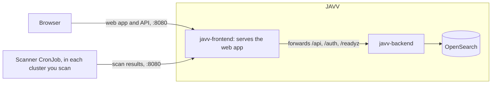

# Deploying JAVV

This page tells you how to install JAVV and connect the scanners. It also tells you how to verify
the published images and how to use an OpenSearch that you operate.



- **javv-frontend** serves the web app. It sends `/api`, `/auth` and `/readyz` to the backend.
  Thus browsers and scanners use one address, and you do not need a proxy.
- **javv-backend** holds the API, the ingest endpoint and the background jobs (staleness,
  lifecycle, exports and cleanup). It runs the jobs itself, on cron schedules. Use one backend for
  each OpenSearch.
- **OpenSearch** holds all the data.
- **Scanners** run in the clusters that they scan. They push their results to JAVV over HTTP, from
  any place that can connect to the JAVV address. JAVV never connects to a cluster that you scan.

There are two installation methods. They use the same images, settings and defaults:

- [Docker compose, on one machine](#install-with-docker-compose)
- [Helm charts, on Kubernetes](#install-on-kubernetes-with-helm)

## Install with docker compose

### Prerequisites

- Docker Engine with the compose plugin 2.23.1 or later.
- A POSIX shell (Linux or macOS).
- These three files, in one folder:
    - [`compose.yaml`](https://raw.githubusercontent.com/Danube-Labs/javv-poc/v0.8.9/deploy/compose/compose.yaml) <!-- x-release-please-version -->
    - [`.env.example`](https://raw.githubusercontent.com/Danube-Labs/javv-poc/v0.8.9/deploy/compose/.env.example) <!-- x-release-please-version -->
    - [`setup.sh`](https://raw.githubusercontent.com/Danube-Labs/javv-poc/v0.8.9/deploy/compose/setup.sh) <!-- x-release-please-version -->

To get the files, run these commands in an empty folder. `VERSION` is the release that you install.

<!-- x-release-please-start-version -->
```bash
VERSION=0.8.9
for f in compose.yaml .env.example setup.sh; do
  curl -fsSLO "https://raw.githubusercontent.com/Danube-Labs/javv-poc/v$VERSION/deploy/compose/$f"
done
chmod +x setup.sh
```
<!-- x-release-please-end -->

`compose.yaml` names the backend and frontend images of its release.

### Steps

1. **Set the memory map limit for OpenSearch.** Do this one time on each host:
    ```bash
    sudo sysctl -w vm.max_map_count=262144
    ```
    To keep the limit after a reboot, also add it to `/etc/sysctl.conf`.
2. **Make the `.env` file.** In the folder with the three files, run one of these commands:
    ```bash
    ./setup.sh           # .env turns off the cookie's Secure flag, so sign-in works over http
    ./setup.sh --https   # .env keeps the cookie's Secure flag: the browser sends it only over https
    ```
    Use `--https` only when people open JAVV at an `https://` address, through a proxy or a load
    balancer in front of JAVV. JAVV itself serves only http ([http or https](#http-or-https)).

    The script:

    - Copies `.env.example` to `.env`. Only you can read `.env`.
    - Sets the four secrets to long random values that compose does not change. The OpenSearch
      admin password obeys the rules of OpenSearch.
    - Shows the password of the first JAVV admin one time. Keep it for step 4.
    - Shows the `sysctl` command again if the limit of step 1 is too low.
    - Does not change an `.env` that exists. Thus it cannot change the secret key of an
      installation.

    To set the secrets yourself, see [Your own secrets](#your-own-secrets).

3. **Start JAVV:**
    ```bash
    docker compose up -d   # pulls the images of the release the first time
    docker compose ps      # wait until opensearch, backend and frontend all show "healthy"
    ```
    The backend makes its indices at its first start.
4. **Sign in** at `http://<this machine>:8080` as `admin`, with the password that `setup.sh` showed.
    JAVV then asks for a new password (12 characters or more). You must set it before you can do
    other work.

To upgrade later, see [`UPGRADING.md` § With docker compose](UPGRADING.md#with-docker-compose).

### Your own secrets

In place of `setup.sh`, run `cp .env.example .env`, and set these four values. The compose file
does not start without them.

- `JAVV_SECRET_KEY`: the secret key of the backend.
    - Use a long random string: `openssl rand -hex 32`.
    - Keep it for the life of the installation (see the warning below).
- `JAVV_BOOTSTRAP_ADMIN_PASSWORD`: the password of the first JAVV admin.
    - JAVV uses it one time.
    - Use 12 to 256 characters. A longer password stops the backend at start.
- `JAVV_OPENSEARCH_ADMIN_PASSWORD`: the password of the OpenSearch admin.
    - Only OpenSearch and its `healthcheck` use it. JAVV never gets it.
    - OpenSearch reads it one time, at its first start.
    - It must have 8 characters or more, with at least one uppercase letter, one lowercase letter,
      one digit and one special character.
    - It must not be a common password, such as `Password123!`.
    - If OpenSearch refuses the password, the `opensearch` container stops. OpenSearch writes the
      refused value into its log (`docker compose logs opensearch`).
- `JAVV_OPENSEARCH_PASSWORD`: the password of `javv`, the OpenSearch user of the backend.
    - This user has only the `javv` role
      ([An OpenSearch of your own](#an-opensearch-of-your-own)).
    - OpenSearch reads it one time, at its first start.
    - Use a long random string: `openssl rand -hex 24`.

Then set the session cookie for your access ([http or https](#http-or-https)).

> **Warning: keep the secret key.** Set `JAVV_SECRET_KEY` once and do not change it. The backend
> uses it to hash each scanner token and session, and to sign download links. After a change:
>
> - Each scanner gets 401 and needs a new token.
> - Each user must sign in again.
> - Each open download link stops working.

**Special characters in `.env`.** Compose changes some values that have no quotes, and it gives
only a warning. Put the full value in single quotes (`'pa$ss…'`), or obey these rules:

- Write each `$` as `$$`. Compose reads `$name` as a variable: `pa$ss-Word1!` becomes `pa-Word1!`.
  All containers then become healthy, with a password that you did not write.
- A space before `#` ends the value: `pa #ss` becomes `pa`.
- Compose deletes the spaces at the end.
- Compose reads a value that starts with `"` or `'` as a quoted value.
- `"` and `\` in other positions need no change.

**If the passwords do not agree:**

- `opensearch` never becomes healthy, and its log shows that it runs: the admin password in `.env`
  is not the password that OpenSearch took at its first start.
- The backend stops with "refused the credentials in JAVV_OPENSEARCH_USERNAME": the two `javv`
  passwords are different.

[Change an OpenSearch password](UPGRADING.md#change-an-opensearch-password) tells you how to
correct both. It also tells you how to change a password later.

### Install from a checkout

To install a checkout that is not a release (`main`, or a commit between two releases):

1. Use the three files in `deploy/compose/` of the checkout.
2. Make the images with `development/scripts/build-app-images.sh`. The script gives the images the
    names that the compose file uses.
3. Do the [steps](#steps) above. `docker compose up -d` then runs these images, and it pulls
    nothing.

### Two installations on one machine

The compose file gives each installation the project name `javv`. Docker Compose puts this name on
the containers, the volumes and the network. A second installation with the same name in a
different folder uses the containers and the volumes of the first.

**Prerequisites:**

- Memory for two OpenSearch nodes. Each installation runs its own OpenSearch.

**Steps:**

1. Put the three files of the release in a different folder.
2. In that folder, make the `.env` with a project name for this installation:
    ```bash
    COMPOSE_PROJECT_NAME=javv-test ./setup.sh
    ```
    `setup.sh` writes `COMPOSE_PROJECT_NAME=javv-test` to `.env`.

3. In that `compose.yaml`, change the host port of `frontend` (the left side of `"8080:8080"`),
    for example to `"8090:8080"`.
4. Run each `docker compose` command of this installation in its folder. Compose reads the project
    name from the `.env` in that folder.

Do not change the project name of an installation that has data. Its volumes have the old name.
Under a new name, JAVV starts with empty volumes.

### If OpenSearch stays unhealthy

`docker compose up -d` stops with `container javv-opensearch-1 is unhealthy`, and the health
test of OpenSearch gets `401`. To see the results of that test:

```bash
docker inspect javv-opensearch-1 --format '{{range .State.Health.Log}}{{.Output}}{{end}}'
```

The cause: OpenSearch started on the volume of an earlier installation with the same project name.
OpenSearch keeps the passwords of its first start, and the new `.env` has other passwords.
`setup.sh` stops before this occurs. An `.env` that you made or replaced yourself can still cause
it.

Do one of these:

- **To delete the earlier installation and its data:**
    ```bash
    docker compose down -v
    docker compose up -d
    ```
- **To keep the earlier installation:** stop this one with `docker compose down`. Then add
  `COMPOSE_PROJECT_NAME=<new name>` to `.env`, and run `docker compose up -d`.

### http or https

By default, the session cookie has the `Secure` flag. A browser keeps a `Secure` cookie only from
`https` or from `localhost`.

- **With https in front of JAVV** (browsers use an `https://` address, and a proxy, a load balancer
  or a gateway sends their requests to JAVV): keep the default. Delete
  `JAVV_SESSION_COOKIE_SECURE=false` from `.env`. `./setup.sh --https` does this.
- **With plain http** (for example `http://<machine>:8080` on a LAN): set
  `JAVV_SESSION_COOKIE_SECURE=false` in `.env`. `.env.example` sets this value. Without it, the
  sign-in fails, and the sign-in page says that the browser refused the session cookie.

JAVV cannot see a TLS proxy in front of it. Thus it never sets the flag itself.

### Ports and access

- **One published port, 8080, on the frontend.** Browsers and scanners both use it. The frontend
  sends the scanner pushes to the backend. To use a different host port, change the left side of
  `8080:8080` in `compose.yaml`.
- **The backend port (8000) is not published.** This port also serves `/docs`, `/openapi.json` and
  `/metrics`, and `/metrics` needs no sign-in. Publish it only for a system that must connect to
  the backend directly, for example a Prometheus scrape. Use the `ports` block in comments under
  `backend`.
- **OpenSearch is not published.** Its security plugin is on. Two users can sign in with a
  password: `admin`, the superuser of OpenSearch, and `javv`. The backend uses `javv`, which has
  only the `javv` role.
- **The demo security setup of OpenSearch adds six more users.** The password of each of these
  users is its own name. The compose file deletes them before the first start of OpenSearch.
- **The demo admin certificate has full access, with no password.** This is `kirk.pem`.
  [Change an OpenSearch password](UPGRADING.md#change-an-opensearch-password) uses it. Its key is
  in the public image, as are the keys of the demo certificates. Thus each system that can connect
  to OpenSearch on the compose network can use it.
- **The traffic to OpenSearch is not private** from systems on that network. The backend does not
  verify the certificate, and it logs one warning about this at start. The network holds only the
  three JAVV containers. Do not publish the OpenSearch port.
- **Scanner pushes go through the frontend container.** When the frontend container restarts, the
  push in progress stops. The scanner tries the push again, with a longer wait each time, for up to
  6 minutes in each cycle (`JAVV_PUSH_RETRY_BUDGET_SECONDS`). When all tries fail, the scanner
  writes the envelope to its dead-letter file. In its next cycle, it scans and pushes that image
  again.

### Settings

[`deploy/compose/compose.yaml`](../deploy/compose/compose.yaml) lists each setting, with its default
and what it does. [`CONFIGURATION.md`](CONFIGURATION.md) gives more detail.

To change a setting, add `NAME=value` to `.env`, and run `docker compose up -d`. These settings
change most frequently:

- `TZ`: the time zone of the job schedules (default `UTC`).
- `OPENSEARCH_JAVA_OPTS`: the OpenSearch heap (default `-Xms1g -Xmx1g`).
- `JAVV_JOB_<KIND>_CRON` and `JAVV_SCHEDULER_ENABLED`: when the background jobs run.

### Scheduled jobs

The backend runs its background jobs on its own schedules:

- 02:00: staleness.
- 03:00: lifecycle.
- 04:00: findings cleanup.

If the installation already holds data, read
[The first run of the background jobs](UPGRADING.md#the-first-run-of-the-background-jobs) before the
jobs run for the first time.

### Data

- OpenSearch keeps all data in the `opensearch-data` volume.
- `docker compose down` keeps the volume. `docker compose down -v` deletes it.
- The snapshots that you make in **Settings › Data & OpenSearch** are on the same volume
  (`path.repo`). Copy them to a different machine yourself.
- JAVV does not make scheduled snapshots yet.

## Install on Kubernetes with Helm

### Prerequisites

- A Kubernetes cluster, and `kubectl` and Helm that can connect to it.
- bash and `openssl`. The commands read each secret at a prompt, or make it in place. Thus no
  secret goes into your shell history or into the arguments of a process.
- One namespace for `javv-opensearch` and `javv`.
- Nodes with amd64 CPUs.
- Read [What the charts need from your cluster](#what-the-charts-need-from-your-cluster) before you
  install.

### The charts

- `javv-opensearch`: OpenSearch.
- `javv`: the backend and the frontend.
- `javv-scanner`: the scanners, in each cluster that you scan
  ([Connect the scanners](#connect-the-scanners)).

Each release publishes the three charts at `oci://ghcr.io/danube-labs/charts/<chart>`, with the
version of the release, and signs them
([Verify the images and charts](#verify-the-images-and-charts)). The README of each chart lists all
of its values.

From a checkout that is not a release, use `deploy/helm/<chart>` in place of
`oci://ghcr.io/danube-labs/charts/<chart> --version "$VERSION"`.

### What the charts need from your cluster

The answers are for the default values of the three charts.

| Question | Answer |
|---|---|
| Privileged containers, host access | None. No container has `privileged: true`. No pod uses `hostPath`, the host network or sysctls. |
| Memory map limit (`vm.max_map_count`) | The charts do not change it ([The memory map limit](#the-memory-map-limit)). |
| Pod Security level | `javv` and `javv-scanner`: `restricted`. `javv-opensearch`: `baseline`, as the official OpenSearch chart ([Pod Security](#pod-security)). |
| Objects outside the namespace (RBAC) | Only `javv-scanner` makes them: one ClusterRole and its ClusterRoleBinding. The scanners can `list` pods and `get` the `kube-system` namespace. They cannot read Secrets. No chart makes CRDs or webhooks. |
| CPU | amd64 only. |
| Images | `ghcr.io/danube-labs/javv-backend`, `javv-frontend`, `javv-scanner-trivy` and `javv-scanner-grype`, and `opensearchproject/opensearch` from Docker Hub. For a mirror, set the `image.repository` value of each image in its chart. Docker Hub limits the pulls of anonymous users, so a mirror of the OpenSearch image also prevents refused pulls. |
| Connections out | The frontend connects to the backend, and the backend to OpenSearch. The scanners connect to the registries of the images that they scan, to the sources of the vulnerability databases and to the JAVV address. The default database hosts are `mirror.gcr.io`, then `ghcr.io` and `pkg-containers.githubusercontent.com` for Trivy, and `grype.anchore.io` for Grype ([mirrors](#what-the-scanner-chart-runs)). |
| Ports and sign-in | 8080: the frontend Service. Each API call needs a session or a scanner token, except the sign-in, the sign-out and `/readyz`. 8000: the backend, `ClusterIP` only ([Open routes on port 8000](#open-routes-on-port-8000)). 9200: OpenSearch, `ClusterIP` only, with a password or a client certificate. |
| Certificates | By default, OpenSearch uses its demo certificates. With them, the demo admin certificate of the public image has full access to OpenSearch. With your own certificates ([Steps](#steps), step 1), it has no access. Use your own certificates for each installation that is not a trial. |
| Storage | OpenSearch: one 8Gi `ReadWriteOnce` volume, the default of the official chart. `javv-scanner`: one 10Gi `ReadWriteOnce` volume for each scanner. Both use the default StorageClass. |
| CPU and memory requests | Only OpenSearch has requests: 1 CPU and 100Mi, from the official chart. Its heap is 1 GB (`opensearch.opensearchJavaOpts`), more than the request. Thus Kubernetes can put OpenSearch on a node without the memory for it. Set `opensearch.resources.requests.memory` to 2Gi or more. The OpenSearch docs recommend a heap of half the memory or less. |
| NetworkPolicy | The charts make none. To limit the connections, allow port 8000 only from the frontend pods, and port 9200 only from the backend pods. |
| Tested on | The CI installs the charts in kind. On 2026-10-20, this was kind v0.33.0 with Kubernetes v1.37.0. |
| Uninstall | `helm uninstall` keeps the volume of OpenSearch, because a StatefulSet makes it. To delete the data, also delete that PersistentVolumeClaim. |

#### The memory map limit

- The charts do not set `vm.max_map_count`, and no container changes the node.
- On 2026-10-20, our development OpenSearch (one node, 42 indices, 1.74 million documents) used 1118
  memory maps. The default limit of Linux is 65530. This is a measurement of one store, not a load
  test. The CI does not run the charts on a node at 65530.
- To get a higher limit, use one of these:
    - Set `vm.max_map_count=262144` on the nodes. The OpenSearch docs recommend this for
      production.
    - Set `opensearch.sysctlInit.enabled=true`. An init container of the official chart then sets
      the limit on the node. This container has `privileged: true` and runs as root.
    - Add `node.store.allow_mmap: false` to `opensearch.config."opensearch.yml"`. OpenSearch then
      uses no memory maps for its index files, and the limit has no effect. Reads are slower. Helm
      replaces the full `opensearch.yml` value. Thus copy the full value from
      `deploy/helm/javv-opensearch/values.yaml` and add the line, or the TLS settings of the chart
      go away.

#### Pod Security

- `javv` and `javv-scanner`: each container runs as user 65532, with `runAsNonRoot`,
  `seccompProfile: RuntimeDefault`, `allowPrivilegeEscalation: false`, no capabilities and a
  read-only root file system.
- `javv-opensearch`: each container runs as user 1000, with `runAsNonRoot` and no capabilities. The
  official chart does not set `seccompProfile` or `allowPrivilegeEscalation: false`.
- To make the OpenSearch pod meet `restricted`, add these values:
    ```yaml
    opensearch:
      securityContext:
        allowPrivilegeEscalation: false
      podSecurityContext:
        seccompProfile:
          type: RuntimeDefault
    ```
    We checked the pod that `helm template` makes with these values. The CI does not start
    OpenSearch with them.
- The `helm test` Pod of `javv-opensearch` meets `restricted` with the default values.

#### Open routes on port 8000

The backend serves these routes with no sign-in. Of these routes, the frontend sends only `/readyz`
to the backend.

- `/metrics`: Prometheus metrics. No label holds a user, a cluster, a token or an image.
  [Metrics](API.md#metrics) lists each metric and its labels.
- `/docs` and `/openapi.json`: the description of the API. The same description is in the
  repository (`frontend/openapi.json`). An API call from `/docs` needs the same sign-in or token as
  any other API call.
- `/healthz` and `/readyz`: the health checks.

### Steps

Install `javv-opensearch` and `javv` in the same namespace, in this sequence.

1. **Install OpenSearch, with its two passwords in Secrets:**
    - `admin`: only OpenSearch uses it. OpenSearch refuses a weak password, with the same rules as
      for compose ([Your own secrets](#your-own-secrets)).
    - `javv`: the user of the JAVV backend, with only the `javv` role
      ([An OpenSearch of your own](#an-opensearch-of-your-own)).

    <!-- x-release-please-start-version -->
    ```bash
    VERSION=0.8.9
    read -rs -p 'OpenSearch admin password: ' pw && echo
    printf '%s' "$pw" | kubectl create secret generic javv-opensearch-admin --from-file=password=/dev/stdin
    unset pw
    kubectl create secret generic javv-opensearch-backend \
      --from-file=password=<(openssl rand -hex 24 | tr -d '\n')
    helm install store oci://ghcr.io/danube-labs/charts/javv-opensearch --version "$VERSION" \
      --set opensearch.javv.auth.existingSecret=javv-opensearch-admin \
      --set opensearch.javv.backend.existingSecret=javv-opensearch-backend
    ```
    <!-- x-release-please-end -->

    This uses the demo certificates of OpenSearch, as compose does. For your own certificates, set
    one of these values. The [chart README](../deploy/helm/javv-opensearch/README.md) describes
    both.

    - `opensearch.javv.tls.existingSecret`: a Secret with `tls.crt`, a PKCS#8 `tls.key` and
      `ca.crt`.
    - `opensearch.javv.tls.certManager`: the chart asks your cert-manager Issuer for a certificate.

2. **Make the two JAVV secrets.** They are the same two secrets as in the `.env` of compose.
    ```bash
    read -rs -p 'First JAVV admin password (12 characters or more): ' pw && echo
    kubectl create secret generic javv-secrets \
      --from-file=secret-key=<(openssl rand -hex 32 | tr -d '\n') \
      --from-file=bootstrap-admin-password=<(printf '%s' "$pw")
    unset pw
    ```
    `secret-key` is `JAVV_SECRET_KEY`, the secret key of the backend. Do not change it
    ([Your own secrets](#your-own-secrets) gives the reason).
3. **Install JAVV.** The backend signs in to OpenSearch as `javv`, with the Secret of `javv`:
    <!-- x-release-please-start-version -->
    ```bash
    VERSION=0.8.9
    helm install javv oci://ghcr.io/danube-labs/charts/javv --version "$VERSION" \
      --set secrets.existingSecret=javv-secrets \
      --set opensearch.passwordSecret.name=javv-opensearch-backend
    helm test javv
    ```
    <!-- x-release-please-end -->
    If OpenSearch uses its own certificate, also add `--set opensearch.caSecret.name=<the Secret with
    its ca.crt>`. With cert-manager, this Secret is `store-javv-opensearch-tls`. The backend then
    verifies the certificate.
4. **Sign in** through the `javv` Service on port 8080, as `admin`, with the bootstrap password.
    - Nothing is in front of the Service. For `https`, put your own Ingress, gateway or load
      balancer in front of it, and keep the session cookie `Secure`
      ([http or https](#http-or-https)).
    - To look at JAVV before you do this, run `kubectl port-forward svc/javv 8080`, and open
      `http://localhost:8080`. Chromium (Chrome) and Firefox keep the `Secure` cookie from
      `localhost`. We did not test Safari. If Safari does not keep you signed in, set
      `backend.config.JAVV_SESSION_COOKIE_SECURE=false`.

To upgrade, or to go back to a previous release, see
[`UPGRADING.md` § On Kubernetes (Helm)](UPGRADING.md#on-kubernetes-helm).

### What the `javv` chart runs

- One backend, with `strategy: Recreate`. The backend runs the background jobs itself. A rolling
  update can run two backends for a short time, so the chart does not use one.
- The ClusterIP Service of the backend, on port 8000.
- The Service of the frontend, on port 8080. Browsers and scanners use this Service.
- The backend and the frontend run as the user of their images, with a read-only root file system.

Each backend setting is under `backend.config` in `deploy/helm/javv/values.yaml`, with the same
default and comment as in the compose file. To change a setting, use
`--set backend.config.TZ=Europe/Bucharest`, or your own values file.

**Access:** only what you put in front of the `javv` Service.

- The backend Service and the OpenSearch Service are ClusterIP.
- The sign-in and the certificates of OpenSearch are as in step 1.
- With the demo certificates, each system in the cluster that can connect to the OpenSearch Service
  can read its traffic and use the demo admin certificate of the image. This is the same as on the
  compose network.

## Connect the scanners

The scanners run in the cluster that they scan. This can be a different cluster, or a different
network. Each pair of a cluster and a scanner has its own token.

### Prerequisites

- A running JAVV, and an address of JAVV that the scanned cluster can connect to.
- An admin sign-in to JAVV.
- `kubectl` and Helm for the scanned cluster, and bash.

### Steps

1. Find the ID of the cluster. The ID is the UID of the `kube-system` namespace:
    ```bash
    kubectl get namespace kube-system -o jsonpath='{.metadata.uid}'
    ```
2. In JAVV, go to **Settings › Access & tokens › Mint token**.
    - In **Cluster**, select **New cluster…** and enter the cluster ID.
    - Select the scanner (`trivy` or `grype`).
    - JAVV shows the token only one time.
    - For the second scanner's token, select the cluster in the list.

3. Install the `javv-scanner` chart in that cluster. Put each token in its own Secret, and set the
    address of JAVV:
    <!-- x-release-please-start-version -->
    ```bash
    VERSION=0.8.9
    kubectl create namespace javv-scanner
    # asks for each token, so it is not in your shell history or the process list
    for s in trivy grype; do
      read -rs -p "$s token: " token && echo
      printf '%s' "$token" | kubectl -n javv-scanner create secret generic "javv-$s-token" \
        --from-file=token=/dev/stdin
    done; unset token
    helm install scanner oci://ghcr.io/danube-labs/charts/javv-scanner --version "$VERSION" \
      -n javv-scanner \
      --set backendUrl=http://<JAVV's address>:8080 \
      --set trivy.token.existingSecret=javv-trivy-token \
      --set grype.token.existingSecret=javv-grype-token
    helm test scanner -n javv-scanner
    ```
    <!-- x-release-please-end -->
    `helm test` verifies that JAVV replies at that address, and that it accepts each token.

The first push shows in **Scanner status**. Its findings show when the scan is complete.

Without Kubernetes, run the scanner image with `JAVV_BACKEND_URL`, `JAVV_TOKEN` and
`JAVV_CLUSTER_ID` ([Scanner settings](CONFIGURATION.md#scanner-settings)).

### Scan images from private registries

The scanners pull each image from its registry. For a registry that requires a sign-in, give the
scanners a login. Kubernetes puts the login into the scan container as a file. The scanners do not
read Secrets through the Kubernetes API.

**Prerequisites:**

- An account on the registry that can only pull images. The scanner process reads the content of
  images that you do not control, and it can read this login.
- `jq`.

**Steps:**

1. Put the login in a Secret of the type `kubernetes.io/dockerconfigjson`, in the namespace of the
    scanners. The password goes in at a prompt:
    ```bash
    read -rs -p "registry password: " pw && echo
    P=$pw jq -n --arg r registry.example.com --arg u <user> \
      '{auths: {($r): {auth: (($u + ":" + env.P) | @base64)}}}' |
      kubectl -n javv-scanner create secret generic javv-registry \
        --type=kubernetes.io/dockerconfigjson --from-file=.dockerconfigjson=/dev/stdin
    unset pw
    ```
    For more registries, put one entry for each registry in `auths`. `kubectl create secret
    docker-registry` makes the same Secret, but it gets the password as an argument.
2. Give the Secret to each scanner. Add these values to the install command of
    [Connect the scanners](#connect-the-scanners), or to your values for the next `helm upgrade`:
    ```bash
    --set trivy.registryAuth.existingSecret=javv-registry \
    --set grype.registryAuth.existingSecret=javv-registry
    ```
3. After the next cycle, make sure that **Running images** shows the images from that registry.
    When the login is missing or wrong, the log of the scan has `scan failed, image skipped`. Its
    `scanner_stderr` holds the error of the registry, for example `UNAUTHORIZED`:
    ```bash
    kubectl -n javv-scanner logs job/<job> -c trivy | grep 'image skipped'
    ```

Without Kubernetes, put the login in a file with the name `config.json`, mount its directory into
the scanner container, and set `DOCKER_CONFIG` to that directory.

### What the scanner chart runs

The [chart README](../deploy/helm/javv-scanner/README.md) lists all of its values.

- **One CronJob for each scanner.** By default, each CronJob runs every 6 hours. Grype starts half
  an hour after Trivy. Kubernetes stops a cycle after 5 hours and 30 minutes. Each scanner has its
  own token, settings, image and cache.
- **One cycle at a time.** A CronJob never starts a cycle while one of its own cycles runs. The
  CronJob does not see a cycle that you start manually. Thus pause the CronJob first, and start your
  cycle when no cycle runs. The `NOTES` of the chart give the commands.
- **A vuln-DB cache for each scanner,** on a 10Gi `ReadWriteOnce` volume.
    - Each cycle first updates the DB on this volume. Then it scans all images against that DB,
      with updates off.
    - The installation runs one update immediately. Thus the first cycle finds a DB, and the volume
      is bound for `helm install --wait`.
    - When an update fails, the scanner uses the DB in the cache. Grype refuses a DB that is older
      than 5 days.
- **The DB sources:** by default, the sources of the scanner vendors, over the internet. To use a
  mirror, set `trivy.vulnDb.repository` and `trivy.vulnDb.javaRepository` (OCI repositories), or
  `grype.vulnDb.updateUrl` (a DB listing).
- **What the scanners can read in the cluster (RBAC):** the pods in all namespaces, to find the
  images that run, and the `kube-system` namespace, because its UID is the cluster ID. They can read
  nothing more, and no Secrets. A registry login comes as a file in the scan container
  ([Scan images from private registries](#scan-images-from-private-registries)).
- **The images** are the scanner versions in [`versions.yaml`](../versions.yaml).
    - The published chart names each image by its digest at the time of the release. Thus a cluster
      runs the scanner build of that release.
    - From a checkout, the chart has only the tag, and Kubernetes pulls it at each run. JAVV
      publishes the tag of a version again when it changes the scanner image. To run one exact
      build from a checkout, set `<scanner>.image.digest`.

## Verify the images and charts

Each release signs the backend and frontend images that it publishes, with **cosign keyless**:

- The certificate comes from the GitHub identity of the release workflow.
- The public Rekor transparency log records the signature.
- Each image also has a **signed SPDX SBOM attestation**: the list of the contents of the image.
- The signature and the attestation are for the digest of the image, not for its tag.

### Prerequisites

- cosign 3.x. The release uses the version in `supply_chain.cosign` of
  [`versions.yaml`](../versions.yaml).
- A release after 0.5.1. The images of 0.5.1 and earlier releases have no signature.

### Steps

1. Verify an image and its SBOM attestation:
    <!-- x-release-please-start-version -->
    ```bash
    VERSION=0.8.9
    IMAGE=ghcr.io/danube-labs/javv-backend:$VERSION   # or javv-frontend
    IDENTITY='^https://github\.com/Danube-Labs/javv-poc/\.github/workflows/release-please\.yml@refs/heads/main$'
    ISSUER=https://token.actions.githubusercontent.com

    cosign verify "$IMAGE" --certificate-identity-regexp "$IDENTITY" --certificate-oidc-issuer "$ISSUER"
    cosign verify-attestation "$IMAGE" --type spdxjson \
      --certificate-identity-regexp "$IDENTITY" --certificate-oidc-issuer "$ISSUER" > /dev/null && echo "SBOM attestation OK"
    ```
    <!-- x-release-please-end -->
2. Verify a chart, in the same shell. A chart holds no software packages. Thus it has a signature,
    but no SBOM:
    ```bash
    cosign verify "ghcr.io/danube-labs/charts/javv:$VERSION" \
      --certificate-identity-regexp "$IDENTITY" --certificate-oidc-issuer "$ISSUER"
    ```

The identity accepts only the release workflow when it runs on `main` of this repository. Thus an
image that a different system made fails the verification. Before the release ends, it runs these
commands without a sign-in.

A different workflow signs the scanner images in the same way.
[`scanner/README.md`](https://github.com/Danube-Labs/javv-poc/blob/main/scanner/README.md#verify-a-published-image)
gives its identity. Before the release puts the digest of a scanner image into the published
`javv-scanner` chart, it verifies the signature of that image.

## An OpenSearch of your own

JAVV signs in to OpenSearch as one user, and that user needs one role. The compose file and the
`javv-opensearch` chart make both, with the name `javv`.

**What the role permits:** only the calls that the backend makes.

- Its own indices: `findings`, `javv-*` and `system-*`.
- The `restored-*` copies that a restore from **Settings › Data & OpenSearch** writes. The Data
  inspector lists these copies, but it never reads them, because a copy of `system-users` holds
  password hashes.
- The snapshots of its indices, and the health of the cluster.

**What the role does not permit:** to read the documents of other indices, to change the cluster
settings, to register a snapshot repository or to use the security API.

**Permissions that apply to more than the JAVV indices.** OpenSearch verifies them at the cluster
level:

- `cluster:monitor/state`: the index list of the Data inspector needs it. It also lets the user read
  the metadata of the cluster: the name, the settings and the mappings of each index, including the
  indices of OpenSearch. It never gives their documents.
- `cluster:admin/snapshot/create`: OpenSearch does not limit it to the JAVV indices. The user can
  copy any index into a repository that you registered. JAVV makes snapshots only of its own indices.
- `cluster:monitor/nodes/stats` and `cluster:monitor/shards`: the runtime card and the shard list
  of the Data inspector use them. They show the statistics and the shards of each index.
- `indices:admin/index_template/put`: it can write a template for any index pattern. The index setup
  writes only the JAVV templates.
- The bulk, multi-get and scroll calls. OpenSearch still verifies their documents against the index
  permissions.

We showed that JAVV needs each permission: the role test fails without it.

### Prerequisites

- A user that can change the security configuration of OpenSearch (its `admin`).
- `curl` and `jq`.
- A long random password for `javv`.

### Steps

1. Save the role below as `javv-role.json`.
2. Make the role, the user and the role mapping. Each `curl -u admin` asks for the password of
    `admin`. The commands read the password of `javv` at a prompt, and write it only to a file that
    only you can read. Thus neither password goes into your shell history or into the arguments of
    a process.
    ```bash
    OS=https://<your opensearch>:9200
    curl -u admin -X PUT "$OS/_plugins/_security/api/roles/javv" \
      -H 'content-type: application/json' --data-binary @javv-role.json
    read -rs -p 'Password of javv: ' pw && echo
    (umask 077; printf '%s' "$pw" | jq -Rs '{password: .}' > javv-user.json)
    unset pw
    curl -u admin -X PUT "$OS/_plugins/_security/api/internalusers/javv" \
      -H 'content-type: application/json' --data-binary @javv-user.json
    rm javv-user.json
    curl -u admin -X PUT "$OS/_plugins/_security/api/rolesmapping/javv" \
      -H 'content-type: application/json' -d '{"users": ["javv"]}'
    ```
3. Set `JAVV_OPENSEARCH_USERNAME=javv` and `JAVV_OPENSEARCH_PASSWORD`
    ([Connection to OpenSearch](CONFIGURATION.md#connection-to-opensearch)).
4. For snapshots, register a repository yourself (`PUT _snapshot/<name>`, with its credentials in
    the keystore of OpenSearch). The JAVV role cannot do this.

`javv-role.json`:

```json
{
  "description": "JAVV backend: its own indices, their snapshots, and cluster health",
  "cluster_permissions": [
    "cluster:monitor/main",
    "cluster:monitor/health",
    "cluster:monitor/nodes/info",
    "cluster:monitor/nodes/stats",
    "cluster:monitor/state",
    "cluster:monitor/shards",
    "indices:admin/index_template/get",
    "indices:admin/index_template/put",
    "cluster:admin/snapshot/get",
    "cluster:admin/snapshot/create",
    "cluster:admin/snapshot/restore",
    "indices:data/write/bulk",
    "indices:data/read/mget",
    "indices:data/read/scroll*"
  ],
  "index_permissions": [
    {
      "index_patterns": [
        "findings",
        "javv-*",
        "system-*"
      ],
      "allowed_actions": [
        "indices:data/read/*",
        "indices:data/write/*",
        "indices:admin/create",
        "indices:admin/get",
        "indices:admin/mapping/put",
        "indices:admin/mappings/get",
        "indices:admin/aliases",
        "indices:admin/aliases/get",
        "indices:admin/refresh*",
        "indices:monitor/*"
      ]
    },
    {
      "index_patterns": [
        "javv-*",
        "system-audit-log*"
      ],
      "allowed_actions": [
        "indices:admin/rollover"
      ]
    },
    {
      "index_patterns": [
        "javv-*"
      ],
      "allowed_actions": [
        "indices:admin/delete"
      ]
    },
    {
      "index_patterns": [
        "restored-*"
      ],
      "allowed_actions": [
        "indices:admin/create",
        "indices:data/write/*",
        "indices:monitor/*"
      ]
    }
  ]
}
```

## A forgotten password

A user who forgets the password asks an admin. The admin gives the user a temporary password with
**Reset password** in **Settings › Users & roles**. The user sets a new password at the next
sign-in.

When no admin can sign in, reset the password of an admin from a shell in the backend container:

```bash
docker compose exec backend python -m backend.auth.reset_password admin          # compose
kubectl exec deploy/javv-backend -- python -m backend.auth.reset_password admin  # Helm, release javv
```

Type the username exactly, in the same case as the user has. The command:

- Shows a temporary password one time, and nothing more. Sign in with it. JAVV then asks for a new
  password before you can do other work.
- Ends all sessions of that user.
- Writes a `pwd_reset` row to the audit log, with `system` as the actor.
- Refuses a user whose password belongs to an identity provider.
- If it cannot end the sessions, still shows the new password, says that the sessions were not
  ended, and stops with exit code 1. Run it again: it gives a new password and ends the sessions.

Also:

- A user that too many failed sign-ins locked out stays locked out for `JAVV_LOGIN_LOCKOUT_MINUTES`
  (15 by default). The lockout is in the memory of the running backend. Wait until it ends, or
  restart the backend.
- A change to `JAVV_BOOTSTRAP_ADMIN_PASSWORD` does not reset a password. JAVV reads it only when the
  admin does not exist.

## Known limits

- **A full OpenSearch disk makes JAVV read-only.** Past the flood-stage disk watermark (95% by
  default), OpenSearch refuses writes. Reads still work.
    - Sign-in and each change fail with `The store is read-only: its disk is full`, and a banner
      says so on each screen.
    - Scanner pushes fail, and the scanner tries again in its retry budget.
    - Free disk space, or add disk. OpenSearch then lifts the block itself, and JAVV needs no
      restart. See the [sizing runbook](runbooks/opensearch-sizing.md).
- **amd64 only.** The images and the scanner images are for amd64.
- **Releases with published images:** 0.5.1, and the releases after 0.6.0.
    - 0.5.0 has no images.
    - The release run of 0.6.0 stopped before it published (its compose test had no value for a
      required setting). Thus 0.6.0 has no images and no charts. Use the release after it.
- **The first release with published charts is the release after 0.6.0.** For earlier releases,
  install from `deploy/helm/` in a checkout.
- **An OpenSearch of your own with its security plugin on** works from the 0.6 releases. Set
  `JAVV_OPENSEARCH_URL` to its address. Set `JAVV_OPENSEARCH_USERNAME`, `JAVV_OPENSEARCH_PASSWORD`
  and, for a private CA, `JAVV_OPENSEARCH_CA_BUNDLE`
  ([Connection to OpenSearch](CONFIGURATION.md#connection-to-opensearch)). The user needs the `javv`
  role ([An OpenSearch of your own](#an-opensearch-of-your-own)).
- **The OpenSearch of the compose file uses demo certificates**
  ([Ports and access](#ports-and-access)). For your own certificates, operate your own OpenSearch,
  and connect JAVV to it as above.
- **TLS is your work.** JAVV serves plain http. Put `https` in front of it with the tools that you
  already operate, and keep the session cookie `Secure`.
- **The build of the frontend image sets the `VITE_*` settings**
  ([Frontend build settings](CONFIGURATION.md#frontend-build-settings)). You cannot change them
  later. A published image has their default values.
- **A private registry needs a static login.** The scanners use the login in the Secret that you
  give them ([Scan images from private registries](#scan-images-from-private-registries)).
    - The scanner images have no credential helpers. Thus a registry whose logins expire after some
      hours needs a process of your own that writes a new login into the Secret before the old one
      expires.
    - Without a login that works, the pull fails: the scanner skips the image, and it writes a
      warning in its log.
- **The scanners see each pod spec.** To find the images, they list the pods. This also shows each
  value in the `env` of a pod. Keep secrets in Secrets.
- **No maintenance switch.** JAVV has no setting that shows a maintenance page. See
  [Upgrades and restarts](#upgrades-and-restarts).
- **JAVV shows the namespaces of an image, not its workloads.** See
  [Find the workloads of an image](#find-the-workloads-of-an-image).

### Upgrades and restarts

While the backend stops for an upgrade or a restart:

- An open app shows the banner "The backend is not answering. Screens cannot load until it is
  back." The banner goes away when the backend answers again.
- The sign-in page says that the server is not answering, and tries again on its own.
- A scanner tries each push again, for at most `JAVV_PUSH_RETRY_BUDGET_SECONDS` in each cycle. A
  cycle that starts while the backend does not run scans nothing. The next cycle scans all the
  images again.

The frontend image also holds a maintenance page, `/maintenance.html`. It needs no backend and no
OpenSearch. If a proxy is in front of JAVV, it can show this page during an upgrade or a restore:

1. Copy the page into the files of the proxy.
2. Make the proxy answer each path with this page and the status 503. A scanner then gets a 503 and
    tries again later. An example for nginx, with the page in its `root`:
    ```nginx
    error_page 503 /maintenance.html;
    location = /maintenance.html {
      internal;
      add_header Cache-Control "no-store" always;
      add_header Retry-After "60" always;
    }
    location / { return 503; }
    ```
3. Delete the rule when JAVV runs again.

### Find the workloads of an image

A scanner scans each image one time, also when many pods run it. JAVV records only the namespaces
where the image runs. To find the workloads:

**Prerequisites:**

- `kubectl` with the context of that cluster, and `jq`.

**Steps:**

1. Copy the digest (`sha256:...`) from the image page, under the image name.
2. Run this command:
    ```bash
    DIGEST=sha256:...
    kubectl get pods --all-namespaces --output json | jq --raw-output --arg digest "$DIGEST" '
      .items[]
      | select(any(.status.containerStatuses[]?; .imageID | endswith($digest)))
      | (.metadata.ownerReferences[0] // {kind: "Pod", name: .metadata.name}) as $owner
      | (.metadata.labels["pod-template-hash"] // "") as $hash
      | if $owner.kind == "ReplicaSet" and $hash != "" and ($owner.name | endswith("-" + $hash))
        then [.metadata.namespace, "Deployment", ($owner.name | rtrimstr("-" + $hash))]
        else [.metadata.namespace, $owner.kind, $owner.name]
        end
      | @tsv' | sort --unique
    ```

Each line gives a namespace, a kind and a name:

- For a pod of a Deployment: the Deployment.
- For other pods: the owner of the pod, for example a DaemonSet or a StatefulSet.
- For a pod with no owner: the pod.
